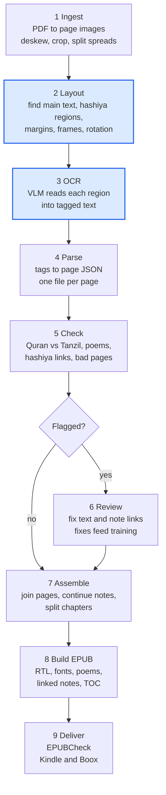
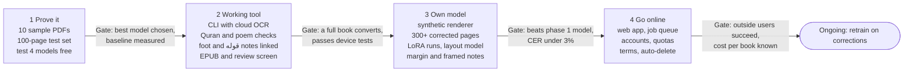

# Arabic Scanned PDF to EPUB Converter — Design Specification

*As of 18 October 2026*

## Contents

1. [Summary and goals](#1-summary-and-goals)
2. [How it works](#2-how-it-works)
3. [The page model](#3-the-page-model)
4. [OCR engine](#4-ocr-engine)
5. [Special content: Quran verses and poetry](#5-special-content-quran-verses-and-poetry)
6. [Hashiya (حاشية): notes attached to the main text](#6-hashiya-حاشية-notes-attached-to-the-main-text)
7. [Building the EPUB for Kindle and Boox](#7-building-the-epub-for-kindle-and-boox)
8. [Training your own model](#8-training-your-own-model)
9. [Measuring quality](#9-measuring-quality)
10. [Tech stack and project structure](#10-tech-stack-and-project-structure)
11. [Going online](#11-going-online)
12. [Roadmap and rough costs](#12-roadmap-and-rough-costs)
13. [Risks and open questions](#13-risks-and-open-questions)
14. [Sources](#14-sources)

---

## 1. Summary and goals

Build a Python tool that sends each scanned page to an open vision-language model (VLM) running on a rented cloud GPU, gets back structured text, then rebuilds the book as a right-to-left, reflowable EPUB3. It starts as a command-line tool driven from your laptop and later becomes a web app using the same engine.

**Constraints**

- **No local GPU.** Model inference and training run on rented GPUs; the laptop does only light work (splitting the PDF, building the EPUB, reviewing pages).
- **Open models in the main path.** No dependence on a proprietary OCR API, so the tool can later be self-hosted and published. A large commercial model may still be used offline to help create training labels.
- **Two target readers:** Kindle (through Send to Kindle) and Boox.
- **Three content types need special care:**
  - Quran verses in ornate brackets ﴿ ﴾
  - classical poetry laid out as two half-lines (صدر and عجز)
  - حاشية: commentary and notes that explain marked words of the main text (متن), printed at the foot of the page, in the margins, or in a separate frame

**Success criteria for version 1** (targets to calibrate once the first test set exists)

1. Character error rate (CER) under 3% on your own test pages, measured with diacritics removed, and reported separately with diacritics kept.
2. Every Quran verse in the output is either matched to the canonical text and replaced by it, or flagged for review. None passes through unchecked.
3. Every poem verse (بيت) keeps its two half-lines together and in order.
4. Every حاشية note is found and linked to the words it explains, or flagged. Over 95% of notes are linked to the right words.
5. The EPUB passes EPUBCheck and displays correctly on at least one Kindle and one Boox device.
6. A full book (about 300 pages) converts unattended, with a short list of flagged pages to review.

---

## 2. How it works

A book passes through nine steps. Only the layout and OCR steps need a GPU, and no page reaches the EPUB until it passes the automatic checks or a human review.



*Shaded steps run on a rented cloud GPU; every other step runs on your laptop.*

Clean pages go straight to assembly. Flagged pages wait in the review screen, and every fix made there is also saved as training data for the next version of the model.

---

## 3. The page model

The heart of the design is one intermediate format between OCR and EPUB. The model never writes EPUB directly; it writes a page model, and every later step reads and corrects that. This lets you swap models, re-run only bad pages, hand-fix a page, and train a model to emit exactly this format.

**What the model emits:** light tagged text, which is shorter and less error-prone for a model than JSON.

```xml
<h2>باب الصبر</h2>
<p>قال الله تعالى:</p>
<quran>إِنَّمَا يُوَفَّى الصَّابِرُونَ أَجْرَهُم بِغَيْرِ حِسَابٍ</quran>
<p>وقال صلى الله عليه وسلم: «والصبر ضياء»<ref n="1"/></p>
<poem><v><s>على قدر أهل العزم تأتي العزائم</s><a>وتأتي على قدر الكرام المكارم</a></v></poem>
<hashiya pos="bottom">
  <note n="1">رواه مسلم في كتاب الطهارة.</note>
  <note lemma="والصبر ضياء">أي يستضيء به صاحبه في ظلمات الشدائد.</note>
</hashiya>
```

**What the parser stores:** one JSON file per page, which the rest of the pipeline uses.

| Block type | Fields | Notes |
| --- | --- | --- |
| heading | level, text | Levels feed the EPUB table of contents |
| paragraph | text, continues, refs[ ] | `continues` marks a paragraph that runs onto the next page; `refs` holds note markers and their character positions |
| quran | text, ref (surah:ayah), status | status = verified, corrected or flagged (see section 5) |
| quote | text, style | Other bracketed text such as hadith in « » or (( )); bracket style kept as printed |
| matn | text | Main-text words woven into a commentary (شرح ممزوج), usually printed in parentheses or bold |
| poem | verses[ ] of sadr, ajuz | A single-column verse (مشطور or modern poetry) stores sadr only |
| hashiya | region, rotation, notes[ ] | One region of notes: bottom, right margin, left margin, top, or frame |
| note | id, kind, anchor_type, marker, lemma, text, layer, continues, link | One حاشية note; full field list in section 6 |
| figure | crop box | Image cropped from the page and embedded as is |
| unclear | text, confidence | Words the model was unsure of; shown in the review screen |

Running headers and page numbers are recognised and dropped. The printed page number is kept as metadata so the EPUB can carry a page list that matches the paper book.

---

## 4. OCR engine

Start with an open general VLM (Qwen3-VL, about 8B parameters) served on a pay-per-second cloud GPU, test it against Arabic-specialised open models on your own pages, and keep whichever scores best. Then fine-tune it on your kind of books (see section 8).

The evidence points this way. On the KITAB-Bench Arabic OCR benchmark, vision-language models beat classical OCR such as Tesseract and PaddleOCR by about 60% in character error rate ([KITAB-Bench](https://arxiv.org/pdf/2502.14949)). A 2026 study found that fine-tuning on in-domain data beats general-purpose checkpoints ([Mubsir OCR](https://aclanthology.org/people/ali-adel-ali/unverified/)).

**Candidate models to test first**

| Model | Open weights | Why test it | Caveat |
| --- | --- | --- | --- |
| [Qwen3-VL-8B-Instruct](https://huggingface.co/Qwen/Qwen3-VL-8B-Instruct) | Yes | Strong general base; follows a tag format well; can also return region boxes for the layout step; the best base to fine-tune later | Needs Arabic fine-tuning to reach top accuracy |
| [QARI-OCR](https://arxiv.org/abs/2506.02295v1) (Qwen2-VL-2B) | Yes | Built for Arabic with diacritics; CER 0.061 on diacritic-rich text | Trained on synthetic pages; scores far worse (CER 1.80) on the independent KITAB-Bench leaderboard |
| [AIN-7B](https://www.codesota.com/browse/computer-vision/document-ocr/kitab-bench) | Yes | CER 0.20 on KITAB-Bench, closest open model to Gemini 2.0 Flash (0.13) | General Arabic-English model, not book-specific |
| [Baseer](https://arxiv.org/abs/2509.18174) (Qwen2.5-VL-3B) | Not listed as public when checked | Best published Arabic page-to-Markdown results | Use its open 400-page benchmark ([Misraj-DocOCR](https://huggingface.co/datasets/Misraj/Misraj-DocOCR/blob/main/README.md)) even if the model stays closed |
| Tesseract (Arabic) | Yes | Fast, nearly free, CPU only | Too inaccurate as the main engine; used as a cross-check |

**How it runs from a laptop**

- The model is served with **vLLM**, which exposes an OpenAI-style API. Your laptop sends page images over HTTPS and gets tagged text back.
- **Day-to-day conversion: a serverless GPU** (Modal or RunPod Serverless). You pay only while pages are processing and it scales to zero. Modal lists an L40S at $0.000542 per second, about $1.95 per hour ([Modal](https://frontend.modal.com/blog/nvidia-l40s-price-article)).
- **Training and big batches: a rented pod** (RunPod, Vast.ai, Lambda and others). Cheaper per hour, around $0.87 per hour for an L40S in January 2026 ([CyFuture](https://cyfuture.ai/blog/h100-vs-a100-vs-l40s-gpu-rental-guide)), but you start and stop it yourself.
- **Free experiments:** Kaggle or Colab notebooks are enough to try models on a few pages before paying for anything.

**One call or several per page.** Simple pages (main text, plus notes at the foot) are read in one call. Pages with margin or framed حاشية go through the layout step first, and each region is cropped, turned upright and read separately (section 6).

**Prompting rules for the model**

1. Transcribe exactly what is printed. Never correct, complete or modernise the text.
2. Keep diacritics exactly as printed, no more and no fewer.
3. Use only the tags from the page model. Put Quran text in `<quran>` and poems in `<poem>`, with the right-hand half-line first.
4. Put every حاشية region in `<hashiya>` and every note in `<note>`, with its printed marker (`n`) or, for notes that open with قوله, its quoted words (`lemma`). Put each marker found in the main text as `<ref n="…"/>` at the exact spot it is printed.
5. Wrap any word you cannot read in `<unclear>`; never guess.
6. Temperature 0. If the output does not parse, retry once at a higher image resolution, then flag the page.

**Catching bad pages automatically.** VLMs can produce fluent text that is not on the page, or loop and repeat a line. Each page is flagged when its tags fail to parse, a line repeats, its word count differs sharply from Tesseract's count for the same page, its Quran verses fail to match the canonical text, or its notes and markers do not pair up.

---

## 5. Special content: Quran verses and poetry

Quran text is never trusted to OCR alone: every verse is matched against the verified [Tanzil](https://tanzil.net/pub/download/v1.0/) text and replaced by it, or flagged. Poems are checked for structure and rhyme, and optionally for meter, but never rewritten automatically.

### 5.1 Quran verses

1. **Find them.** Take every `<quran>` block, plus any span in ﴿ ﴾ the model left untagged (a regex pass catches these).
2. **Normalise for matching.** Strip diacritics and Quranic annotation marks, unify alef forms (أ إ آ ٱ to ا), ى and ي, ة and ه, and remove tatweel. Uthmani spelling differs from standard spelling (الصلوٰة versus الصلاة), so the index is built from both Tanzil's Uthmani and simple texts. The [rasm_arch](https://pypi.org/project/rasm-arch/) library, which reduces text to its undotted skeleton, can make matching more robust still.
3. **Look up candidates.** A word n-gram index over all 6,236 verses finds candidates fast; a fuzzy score (rapidfuzz) ranks them. Partial verses and quotes spanning two or more verses are both handled.
4. **Decide.** Exact match after normalisation = verified. Similarity above a threshold (start at 0.90, tune on the test set) = corrected. Anything lower = flagged for review.
5. **Replace.** Insert the Tanzil text in the style the book uses: Uthmani if the book prints Uthmani script, simple with diacritics if it prints standard spelling, simple-clean if it prints none. Keep only the part the author quoted.
6. **Bracket correctly.** In logical (typing) order the verse is preceded by U+FD3F ﴿ and followed by U+FD3E ﴾. Plain parentheses or reversed ornate brackets from the model are normalised to this. The reference (surah and verse) is stored and can be shown as a small label, as a footnote, or not at all.

**Licence:** Tanzil's text is under Creative Commons Attribution 3.0. It may be copied verbatim but not changed, and the source must be credited with a link to tanzil.net. The EPUB therefore gets a credits page, and the tool never edits verse text.

### 5.2 Poetry

Typical OCR failures are half-lines swapped (read left to right), two verses merged into one, a verse split at a page break, and decorative separators (*, …) read as text. Each poem is checked:

- **Structure.** Every verse has both halves unless the poem is marked single-column, and the two halves are of similar length.
- **Rhyme.** In a classical poem every second half-line ends on the same rhyme letter (الروي). A verse that breaks the pattern is flagged, which catches merged, missing or swapped lines.
- **Meter (optional).** The open [Ashaar / Qawafi](https://github.com/arbml/qawafi) tools classify the 16 classical meters. A verse whose halves get different meters is flagged. These models work best on diacritised text, so they only flag, never fix.
- **Page breaks.** A page that opens with a poem block and no heading continues the previous page's poem; the two are joined.

Poems quoted inside a حاشية are tagged and checked the same way.

### 5.3 Other bracketed text

Hadith in « » or (( )) and other quotations go into `quote` blocks with their bracket style kept as printed. In commentary books (شرح ممزوج), main-text words printed in parentheses inside the commentary are `matn` spans, not quotes; a per-book setting tells the tool which convention the book uses. Automatic hadith checking against a hadith corpus is left for later (section 13).

---

## 6. Hashiya (حاشية): notes attached to the main text

The tool recognises every حاشية on the page, links each note to the exact words of the main text it explains, and carries that link into the EPUB as a tappable note. The reader can move between the main text and its حاشية as on paper, on a small screen where the page layout itself cannot survive.

### 6.1 Forms the tool must handle

| Form | How it looks on the page | How the note is tied to the main text |
| --- | --- | --- |
| Numbered notes at the foot | Below a rule at the bottom of the page; markers such as (١), [١] or * in the main text | Marker number or symbol |
| قوله notes (lemma notes) | Each note opens with قوله followed by the quoted words of the main text, often in parentheses, bold or overlined, then the explanation | The quoted words (the lemma) are found in the main text |
| Margin notes (هامش) | Printed in the side, top or outer margins, often slanted or rotated, sometimes boxed | A marker, a lemma, or simply sitting beside the line it explains |
| Framed layouts (بهامشه) | Main text in one frame, a second work or commentary in another frame on the same page | Usually by lemma; sometimes two independent texts |
| Mixed commentary (شرح ممزوج) | Main-text words woven into the commentary, set in parentheses or bold | Not a note: tagged as `matn` spans inside the commentary |
| Continued notes | A note runs onto the next page, often marked with = at the break | Joined to the last note of the previous page |
| Layered commentary | متن, then شرح on it, then حاشية on the شرح, sometimes تقريرات on the حاشية | Each layer links to the layer above it |
| Editor's notes (حواشي المحقق) | Same position as the author's notes, in modern critical editions | Marker; kept apart from the author's own notes |

### 6.2 Page model fields for a note

| Field | Values | Purpose |
| --- | --- | --- |
| id | page and sequence, e.g. `p037-n2` | Stable reference used by links and review |
| kind | author, editor, unknown | Editor's notes can be styled or hidden separately |
| region | bottom, margin-right, margin-left, top, frame | Where it was printed |
| anchor_type | marker, lemma, position | How it is tied to the main text |
| marker | the printed sign: ١, ٢, *, ** … | For marker notes |
| lemma | the quoted main-text words after قوله | For lemma notes |
| text | the note itself, with its own tags (Quran, poems, quotes allowed inside) | Content |
| layer | 1 = on the main text, 2 = on the commentary, 3 = on the حاشية | Layered commentary |
| continues_from / continues_to | previous or next page's note id | Notes that cross a page break |
| link | target block id and character offset, plus status: linked, guessed or flagged | The resolved anchor |

### 6.3 Layout step

Margin and framed حاشية break the simple "one page, one model call" approach: margin text is often rotated, and its lines sit level with main-text lines, so a single top-to-bottom reading mixes the two. A layout pass therefore runs before OCR.

1. **Detect regions.** Main text, each حاشية region, frames, running headers and page numbers, each with a bounding box and a rotation angle. In phase 2 the same Qwen3-VL model returns these boxes when asked; in phase 3 a dedicated layout-detection model (for example DocLayout-YOLO), fine-tuned on a few hundred labelled pages, does it faster and more reliably.
2. **Crop, turn upright, read.** Each region is cropped, rotated upright and sent to the model with a region-specific prompt ("this is a حاشية region; return `<note>` elements").
3. **Skip when not needed.** Pages that only have notes at the foot are read in one call, since the model can tag both parts itself.
4. **Reading order.** Main text first, then حاشية regions: foot, then right margin, then left margin, then top, following right-to-left order. Within a margin region, notes keep their printed order.

### 6.4 Linking each note to its words

Links are resolved in this order, and every note ends up linked, guessed or flagged.

1. **By marker.** Each `<ref>` in the main text is paired with the `<note>` carrying the same marker on the same page. Numbering often restarts on every page, and symbols (*, **) repeat, so pairing is always per page. A marker with no note, or a note with no marker, is flagged.
2. **By lemma (قوله).** The lemma and the main text are normalised the same way as for Quran matching, then the lemma is searched in the main text of the same page, and then the previous page, because glosses often lag a page behind. When the lemma occurs more than once, order decides: notes follow main-text order, so each anchor must come after the previous note's anchor. All notes on a page are aligned together as one ordered sequence, which picks the right occurrence. A generated marker is placed at the end of the matched words, since the printed main text has none.
3. **By position.** A margin note with neither marker nor lemma is linked to the main-text line printed level with it. Its status is "guessed", and it is shown in the review screen.
4. **Continuations.** A note region that opens without a marker or lemma, or opens with =, continues the last note of the previous page; the two parts are joined into one note.
5. **Layers.** Layered commentary is resolved from the top down: notes on the main text first, then notes on the commentary, then glosses on the notes.

### 6.5 Checks and review

- Every marker has a note and every note has an anchor.
- Anchors on a page run in the same order as their notes.
- Lemma matches score above a threshold (start at 0.85, tune on the test set); below it, the note is flagged.
- Note numbering on each page runs without gaps (١, ٢, ٣ …); a gap suggests a missed note.
- The review screen draws a line from each note to its anchor, on the page image and in the recognised text. A wrong link is fixed by selecting the right words, and the fix is saved as training data.

### 6.6 Showing حاشية in the EPUB

The display mode is a per-book setting.

| Mode | What the reader sees | Best for |
| --- | --- | --- |
| Pop-up notes (default) | A small marker after the anchored words; tap to open the note, tap to return | Kindle and other readers that show pop-up notes |
| Inline | Notes in a smaller font straight after the paragraph that holds their anchors | Study reading; readers without pop-up support |
| Chapter end | All notes gathered at the end of each chapter, with links in both directions | Long notes; layered commentary |

- **Lemma notes** open with their lemma in bold, as printed: **قوله: (والصبر ضياء)**, then the explanation.
- **Author's notes and editor's notes** get different markers (numbers for the author, letters or asterisks for the editor), and either set can be hidden.
- **Layered commentary** uses chapter-end mode for the second and third layers, because pop-ups inside pop-ups are not reliable on e-readers.
- **Main-text spans** in mixed commentary (شرح ممزوج) are set in bold, with the printed parentheses kept.
- **Framed layouts with two independent works** (a second book printed بهامشه) can be output as two separate sections, or as two EPUBs.

---

## 7. Building the EPUB for Kindle and Boox

Output one plain, standards-clean EPUB3 with simple CSS, embedded open-licence fonts, and tables for poems. E-reader engines handle Arabic unevenly, so simple markup is the safest route, and every release is tested on real devices.

**Device facts that shape the design**

- **Kindle** has officially supported Arabic books since June 2018 on Kindle devices and apps ([Amazon](https://press.aboutamazon.com/2018/6/amazon-launches-support-for-arabic-language-books-on-kindle)). Older reports say a Paperwhite 2 or newer is needed ([eBook Reader Blog](https://blog.the-ebook-reader.com/2018/06/26/kindles-and-kindle-apps-now-support-arabic-language-books/)). Your EPUB reaches a Kindle through Send to Kindle, which converts it on Amazon's side; how well right-to-left personal documents survive that must be tested, with Kindle Previewer as a check.
- **Boox NeoReader** has had Arabic letter-joining problems on some versions; switching to its V2 engine was the suggested fix ([MobileRead](https://www.mobileread.com/forums/showthread.php?p=4214796)). [KOReader](https://f-droid.org/en/packages/org.koreader.launcher.fdroid/), installable on Boox, explicitly supports Arabic and is the fallback reader.

**EPUB rules**

1. `xml:lang="ar"` and `dir="rtl"` on every `<html>`, and `page-progression-direction="rtl"` on the spine so pages turn right to left.
2. Direction comes from `dir` attributes, not the CSS `direction` property, which EPUB validators reject.
3. Embed open (SIL OFL) fonts: Amiri or Noto Naskh Arabic for body text, Amiri Quran for verses. Readers must pick "publisher font" to see them; the book still reads correctly with the device's own Arabic font.
4. Keep digits exactly as printed (Arabic-Indic ١٢٣ or Western 123).
5. One XHTML file per chapter, split at headings, so large books open fast on e-ink.
6. Navigation: a table of contents from headings, plus a page list mapped to the printed page numbers, so citations to the paper edition still work.
7. Notes (author's حاشية and editor's footnotes) use the EPUB3 note pattern (`epub:type="noteref"` on the marker and `epub:type="footnote"` on the note) with a back-link. Kindle shows these as pop-ups; other readers jump and return.
8. Validate every book with EPUBCheck before delivery.

**Poem layout**

Two layouts are generated from the same page model, chosen at build time:

- **Two-column (default for 7-inch and larger screens):** each verse is one table row, right half-line in the right cell, left half-line in the left cell, both centred. Tables are used rather than flexbox or grid because e-reader support for those is unreliable.
- **Stacked (for 6-inch screens and phones):** the first half-line, then the second indented beneath it, with extra space between verses.

Classical print stretches half-lines with kashida so they align; e-readers do not support that reliably, so centring is used instead.

**Device test checklist (each release)**

- [ ] EPUBCheck passes with no errors
- [ ] Kindle via Send to Kindle: letters join, text runs right to left, pages turn right to left, note pop-ups open and return
- [ ] Kindle Previewer shows the same result as the device
- [ ] Boox NeoReader (V2 engine): the same checks
- [ ] Boox KOReader: the same checks
- [ ] Quran brackets ﴿ ﴾ face the right way in all of them
- [ ] All three حاشية display modes work on each device

---

## 8. Training your own model

Fine-tune Qwen3-VL-8B with LoRA on two things: a few hundred real pages from your kind of books, corrected by hand, and synthetic pages rendered from open texts in exactly the page-model tag format. Small real sets go a long way: a public Qwen3-VL-8B LoRA trained on just 280 scanned Arabic government pages, labelled by a model and spot-checked by hand, reached 0.61% CER on its plain-text test pages (diacritics ignored). Training took about an hour on a free Kaggle T4 GPU ([Docora](https://huggingface.co/mohamedwasef/Docora)).

**Training data**

| Source | What it teaches | Size | Notes |
| --- | --- | --- | --- |
| Your own pages, corrected | Your exact fonts, paper, scan noise and layouts, including real حاشية | 300 to 1,000 pages to start | The most valuable data. Produced by fixing model output in the review screen, not by typing from scratch |
| Synthetic pages you render | Poems, Quran brackets, headings and every حاشية form, with perfect labels in the tag format | 20,000 to 50,000 pages | Text from [OpenITI](https://zenodo.org/records/17767721) (premodern Arabic books, including many commentaries), the [Ashaar](https://arxiv.org/abs/2307.06218v1) poetry collection and Tanzil; rendered in many Arabic fonts, then degraded with scan-noise augmentation |
| [SARD](https://huggingface.co/papers/2505.24600) | Book-style page reading at scale | 843,622 pages, 10 fonts | Clean images with no scan noise and plain text only; useful for an early warm-up stage |
| [Misraj-DocOCR](https://huggingface.co/datasets/Misraj/Misraj-DocOCR/blob/main/README.md) | Nothing: kept for testing only | 400 expert-verified pages | Never trained on, so it stays a fair outside benchmark |

The synthetic renderer is the key piece. It lays out real verses and passages as HTML, takes a screenshot, and saves the matching tags. No public dataset teaches a model your output structure, so you generate it. For حاشية it renders:

- numbered notes under a rule at the foot, with markers placed in the main text;
- قوله notes whose lemmas are real phrases taken from that page's main text, so the correct link is known exactly;
- margin notes set at angles, boxed and unboxed, level with the lines they explain;
- notes broken across two pages with the = continuation sign;
- mixed commentary with main-text words in parentheses or bold;
- framed pages with two works side by side.

The same rendered pages also give labelled region boxes for training the layout model.

**Getting labels faster.** Run the best available model over your pages first, then correct only its mistakes. A large commercial model can be used here offline. Check its terms first: some providers forbid using outputs to train other models.

**Recipe**

1. **Base model:** Qwen3-VL-8B-Instruct; the 4B version is the cheaper fallback.
2. **Method:** LoRA on the language layers with the vision encoder frozen, the approach used by both Docora and [Baseer](https://arxiv.org/abs/2509.18174). [Unsloth](https://docs.unsloth.ai/models/qwen3-vl-run-and-fine-tune) supports Qwen3-VL and fits training on small GPUs.
3. **Stage 1:** synthetic pages, so the model learns the tags and the layouts.
4. **Stage 2:** your real corrected pages, with about 15% synthetic pages mixed in so stage 1 is not forgotten.
5. **Layout model (phase 3):** a separate small detector trained on the synthetic region boxes plus a few hundred real pages with boxes drawn in the review screen.
6. **Serving:** merge the LoRA and serve at 16-bit precision. 4-bit quantisation is not recommended for fine-grained OCR ([QARI-OCR](https://huggingface.co/papers/2506.02295)), and diacritics are exactly that.
7. **Keep improving:** every book converted produces corrected pages and corrected note links; retrain when a few hundred new ones have built up.

**Compute.** Experiments fit on free notebooks. Full runs go on a rented L40S, A100 or H100 billed by the hour. Expect a few hours to a day per run for tens of thousands of pages; an estimate to confirm with the first run.

---

## 9. Measuring quality

One fixed test set of about 100 hand-verified pages scores every model and every pipeline change. A new model replaces the current one only if it wins on this set.

**The test set:** about 100 pages from at least 10 books, none ever used in training. It mixes prose, poetry-heavy pages, Quran-heavy pages, pages with each حاشية form (foot, margin, framed, layered), and the worst scans you have. Misraj-DocOCR serves as a second, outside benchmark.

| Metric | What it tells you | Version 1 target |
| --- | --- | --- |
| CER, diacritics removed | Are the letters right? | Under 3% |
| CER, diacritics kept | Is the tashkeel right? | Baseline first, then improve each release |
| Word error rate | How many words need fixing | Baseline first |
| Quran wrong-verse rate | Verses replaced by the wrong verse | 0, checked by hand |
| Quran auto-resolved rate | Verses verified or corrected with no review | Baseline first |
| Poem verse accuracy | Verses with both halves right and in order | Over 95% |
| Block-type accuracy | Headings, poems, quotes, matn spans and notes tagged correctly | Over 95% |
| Note recall | Notes found out of all notes printed | Over 98% |
| Note link accuracy | Notes anchored to the right words | Over 95% |
| Region detection | Pages where every حاشية region was found | Over 97% |
| Missed-error rate | Pages with errors that were not flagged | Under 5% |
| Review time | Minutes of human correction per 100 pages | Falls with each release |

These targets are starting points, to be adjusted once the first baseline is measured. Text is normalised the same way before every score (Unicode NFC, tatweel removed, spaces unified), so scores stay comparable. Diacritics-kept scores are reported separately because research shows VLMs lose much more accuracy when diacritics count ([cross-dataset study](https://arxiv.org/pdf/2608.22366)). Note text is scored with the same CER as the main text.

**The review screen** shows the page image beside the recognised text, with flagged words, verses and note links highlighted. Every fix made there is saved as new training data.

---

## 10. Tech stack and project structure

Everything is Python. The laptop runs the light stages; only the layout and OCR server and training touch a GPU.

| Job | Tool | Runs on |
| --- | --- | --- |
| PDF to page images | PyMuPDF (render at 300 DPI, or extract the original scans untouched) | Laptop |
| Image clean-up | OpenCV: deskew, crop margins, split two-page spreads | Laptop |
| Region detection | Qwen3-VL bounding boxes first; a fine-tuned layout detector later | Cloud GPU |
| Model server | vLLM, deployed on Modal (serverless) | Cloud GPU |
| OCR client | httpx (async), OpenAI-style API calls, retries, per-page cache | Laptop |
| Parsing and checks | lxml for tags, rapidfuzz for Quran and lemma matching, Qawafi for meter | Laptop |
| Note linking | Ordered sequence alignment of lemmas and markers to main text | Laptop |
| Cross-check OCR | Tesseract (Arabic) | Laptop |
| EPUB build | Jinja2 templates and a small custom builder (an EPUB is a zip of XHTML files), or ebooklib | Laptop |
| Validation | EPUBCheck | Laptop |
| Review screen | FastAPI with a simple HTML page, reused later in the web app | Laptop |
| Synthetic data | Playwright (headless Chromium renders HTML pages to images) and scan-noise augmentation | Laptop or cloud CPU |
| Fine-tuning | Unsloth with Hugging Face PEFT/TRL | Rented GPU |

**Project layout**

```
arabic-pdf2epub/
  cli.py              # pdf2epub convert book.pdf
  ingest/             # PDF to page images, clean-up
  layout/
    detect.py         # region boxes and rotation
    crop.py           # crop and turn regions upright
  ocr/
    client.py         # sends pages and regions to the GPU endpoint
    prompts/          # system prompts and tag spec (page, hashiya region)
    serve_modal.py    # vLLM deployment on Modal
  parse/              # tagged text to page JSON
  checks/
    quran.py          # Tanzil matching and replacement
    poetry.py         # structure, rhyme, meter
    hashiya.py        # marker pairing, lemma matching, link checks
    flags.py          # bad-page detection
  assemble/
    pages.py          # join pages, split chapters
    notes.py          # continue notes across pages, resolve layers
  epub/
    builder.py
    templates/  css/  fonts/
  review/             # local review screen
  train/
    synth/            # page renderer (incl. hashiya layouts) and degradation
    finetune.py
    layout_train.py
  eval/               # test set and scoring
  data/tanzil/        # Quran text, verbatim, with its licence
```

**Every stage caches its output** in a work folder per book (`pages/0037.png`, `0037.regions.json`, `0037.tags`, `0037.json`). A crash or a re-run picks up where it stopped, and one bad page can be re-done alone:

```
pdf2epub convert sharh.pdf --layout two-column --notes popup --commentary mixed
pdf2epub review sharh             # opens the review screen
pdf2epub redo sharh --pages 37,112
pdf2epub build sharh --notes inline   # rebuilds the EPUB from the page JSON
```

---

## 11. Going online

The web version reuses the same engine untouched: a web front end, a job queue and file storage are added around it. Running all of it on Modal means there is no server to maintain and you still pay per second of use.

**Components**

- **Web app (FastAPI):** upload a PDF, choose options (poem layout, حاشية display mode, Quran references on or off, commentary style), watch progress, review flagged pages in the browser, download the EPUB.
- **Job runner:** each book becomes a job. CPU steps run as cheap CPU functions; layout and OCR calls go to the GPU endpoint, which scales to zero when idle.
- **Storage:** uploaded PDFs, page caches and finished EPUBs in object storage (Cloudflare R2 or S3), deleted automatically after 7 days by default.
- **Send to Kindle:** email the finished EPUB to the user's Kindle address once they have approved the sending address in their Amazon settings.
- **Accounts and limits:** sign-in, a page quota per user, maximum file size, and rate limits, because every page costs GPU time. Payments (for example Stripe) come only if usage justifies it.

**Rules to settle before launch**

1. **Copyright.** Users will upload books they do not own the rights to. Terms of service should limit use to books the user owns or that are out of copyright, for personal reading. Converted books are never shared between users.
2. **Training data consent.** Uploaded books are never used for training unless the user opts in.
3. **Attribution.** Every EPUB carries the Tanzil credit; the site credits the open models and fonts it uses.
4. **Publishing your model.** If you release the fine-tuned model on Hugging Face, check the licences of the base model and of every training dataset first.

---

## 12. Roadmap and rough costs

Build in four phases, each ending at a gate. A working local tool comes first (phase 2); your own trained model and the web app both build on it, so neither is started until the tool works end to end.



| Phase | What gets built | Gate to move on | GPU spend (estimate) | Basis |
| --- | --- | --- | --- | --- |
| 1 Prove it | 10 sample PDFs, 100-page test set, 4 models tested | Best model chosen, baseline measured | $0 | Free Kaggle or Colab notebooks |
| 2 Working tool | CLI, cloud OCR, Quran and poem checks, foot-of-page and قوله notes linked, EPUB, review screen | A full book converts and passes device tests | Under $20 in total | Test runs on a serverless L40S at about $1.95 per hour |
| 3 Own model | Synthetic renderer, 300+ corrected pages, LoRA runs, layout model, margin and framed حاشية | Beats the phase 1 model; CER under 3%; note link accuracy over 95% | $50 to $200 in total | Several LoRA runs on rented GPUs at roughly $1 to $2.50 per hour |
| 4 Go online | Web app, job queue, accounts, quotas, terms, auto-delete | Outside users succeed; cost per book known | Under $1 per 300-page book, plus storage | Assumes one L40S reads 0.5 to 2 pages per second, plus model start-up time; pages with margin notes cost more because each region is a separate call |

These are estimates from the prices in section 4, to be replaced by measured figures in phase 2.

---

## 13. Risks and open questions

The biggest risk is silent error: fluent text the model invented, a wrong Quran verse, or a note attached to the wrong words, that nobody notices. Most of the design (verification, flags, review, the test set) exists to catch it.

| Risk | What goes wrong | Mitigation |
| --- | --- | --- |
| Invented text | The model writes plausible words that are not on the page | Tesseract word-count cross-check, repetition detection, flags, review screen |
| Wrong Quran verse | A misread passage is "corrected" into a different verse | Conservative threshold; every replacement logged; wrong-verse rate must be 0 on the test set |
| Weak diacritics | Tashkeel errors change meaning and break meter | Scored separately; diacritised synthetic training data; meter check flags verses |
| Wrong note link | A حاشية note is attached to the wrong words, or to the wrong occurrence of a repeated phrase | Ordered alignment of all notes on a page; "guessed" status for position-only links; link lines in the review screen |
| Rotated margin text | Slanted margin notes are misread or mixed into main-text lines | Layout step crops and turns regions upright; synthetic training on angled margins |
| Brackets confused | Main-text words in parentheses (شرح ممزوج), Quran and hadith brackets mixed up | Ornate Quran brackets are distinct; per-book commentary setting; matn spans checked in review |
| Kindle conversion | Send to Kindle breaks right-to-left order, the ornate brackets or note pop-ups | Device test every release; fallback to a Kindle Previewer or calibre AZW3 build; inline and chapter-end note modes |
| Boox rendering | NeoReader fails to join letters | Test with the V2 engine; recommend KOReader |
| Very poor scans | Old, low-resolution or bleed-through pages give high error rates | Higher DPI, clean-up, flags; some books will need manual work |
| GPU costs online | Public use costs more than expected | Quotas, scale-to-zero serving, page cache |
| Copyright online | Users upload books they have no rights to | Terms of service, no sharing between users, automatic deletion |
| Fast-moving models | A better open model appears next month | The OCR backend is pluggable; re-run the test set on new models |

**Open questions for you**

- [ ] Which books come first: classical diwans, modern poetry, religious texts, or commentaries with حاشية? This sets the synthetic data mix.
- [ ] Which حاشية forms appear in your books: foot of page, side margins, framed (بهامشه), layered?
- [ ] Default display for حاشية: pop-up, inline, or chapter end?
- [ ] Show editor's notes (حواشي المحقق) alongside the author's, or hide them by default?
- [ ] Keep diacritics exactly as printed, or also offer automatic diacritisation for undiacritised poems?
- [ ] Show Quran references (surah and verse)? As a label, a footnote, or not at all?
- [ ] Check hadith against a hadith corpus in a later version?
- [ ] Which Kindle and Boox models will be the test devices?
- [ ] Pick 5 to 10 sample PDFs to start the test set, including at least two with حاشية.

---

## 14. Sources

**Models and benchmarks**

- [KITAB-Bench paper](https://arxiv.org/pdf/2502.14949) and [KITAB-Bench leaderboard (CodeSOTA)](https://www.codesota.com/browse/computer-vision/document-ocr/kitab-bench)
- [Mubsir OCR, NAKBA-NLP 2026](https://aclanthology.org/people/ali-adel-ali/unverified/)
- [When Do VLMs Help Arabic Manuscript OCR? (diacritics penalty)](https://arxiv.org/pdf/2608.22366)
- [QARI-OCR paper](https://arxiv.org/abs/2506.02295v1) and [model page](https://huggingface.co/papers/2506.02295)
- [Baseer paper](https://arxiv.org/abs/2509.18174) and [Misraj on Hugging Face](https://huggingface.co/Misraj/models)
- [Misraj-DocOCR benchmark](https://huggingface.co/datasets/Misraj/Misraj-DocOCR/blob/main/README.md)
- [Qwen3-VL-8B-Instruct](https://huggingface.co/Qwen/Qwen3-VL-8B-Instruct)
- [Docora: Qwen3-VL-8B Arabic OCR LoRA](https://huggingface.co/mohamedwasef/Docora)
- [Unsloth Qwen3-VL fine-tuning guide](https://docs.unsloth.ai/models/qwen3-vl-run-and-fine-tune)

**Training text and data**

- [SARD synthetic Arabic book pages](https://huggingface.co/papers/2505.24600)
- [OpenITI corpus release, December 2025](https://zenodo.org/records/17767721)
- [Ashaar poetry datasets and models](https://arxiv.org/abs/2307.06218v1) and [Qawafi](https://github.com/arbml/qawafi)
- [Tanzil Quran text and terms of use](https://tanzil.net/pub/download/v1.0/)
- [rasm_arch](https://pypi.org/project/rasm-arch/)

**Devices and hosting**

- [Amazon: Arabic books on Kindle, June 2018](https://press.aboutamazon.com/2018/6/amazon-launches-support-for-arabic-language-books-on-kindle) and [device notes](https://blog.the-ebook-reader.com/2018/06/26/kindles-and-kindle-apps-now-support-arabic-language-books/)
- [MobileRead: Arabic on Boox NeoReader](https://www.mobileread.com/forums/showthread.php?p=4214796)
- [KOReader](https://f-droid.org/en/packages/org.koreader.launcher.fdroid/)
- [Modal L40S pricing](https://frontend.modal.com/blog/nvidia-l40s-price-article) and [GPU rental prices, January 2026](https://cyfuture.ai/blog/h100-vs-a100-vs-l40s-gpu-rental-guide)
